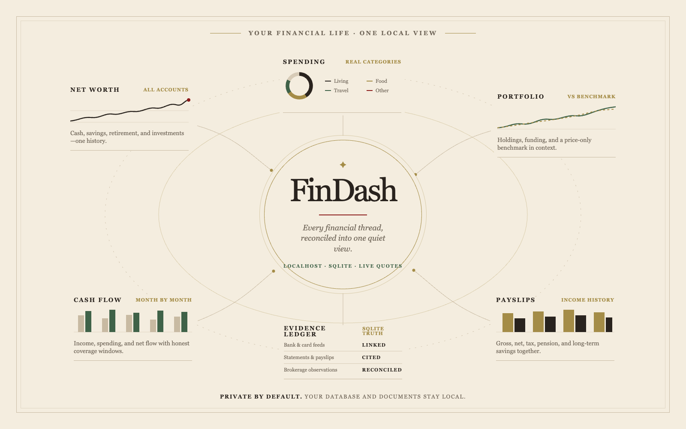

# FinDash

A private, live dashboard that turns personal-finance evidence into a reconciled SQLite ledger.

<p align="center">
  <a href="docs/images/findash-orbit.html">
    
  </a>
</p>

FinDash is a Claude Code plugin (`findash`) with one primary product surface: a
private React dashboard running on localhost. Behind it, a set of skills and a
small deterministic toolchain keep the data trustworthy:

- **Skills reason** over messy real-world records—bank statements, payslips,
  brokerage screenshots, deposits, transfers, and card charges.
- **SQLite keeps the evidence trail** and drives every total shown by the dashboard.
- **The local React app is the main interface**, with intraday quotes refreshed
  every 5 minutes and a full market refresh every 30 minutes while it runs.

The core loop is simple: sync every configured source into SQLite, then open the
dashboard. Data collection and viewing stay independent, so scheduled syncs
can run without opening anything.

> [!NOTE]
> **Built for Israel.** FinDash ships tuned for Israeli personal finance: automatic fetch covers **Bank Hapoalim** and **Cal** (via `israeli-bank-scrapers`), the default reporting currency is **₪ (ILS)**, and the schema models Israeli **payslips** (income tax, Bituach Leumi) and **retirement vehicles** (pension + training fund / קרן השתלמות). Dates parse as **DD/MM** and Hebrew/RTL text is handled throughout. The cash-flow dividend component uses gross modeled entitlement while cash confirmation is incomplete; modeled rows never enter the ledger, and recorded dividend cash and tax remain source-backed facts.
>
> **Living elsewhere?** Nothing is locked in — fork it and swap the locale-specific pieces. See [Adapting to another country](#adapting-to-another-country).

## What It Does

- **Net worth:** cash, savings, retirement, and brokerage value in one history.
- **Portfolio:** holdings and recorded funding compared with a price-only S&P 500 what-if.
- **Spending:** merchant-level card and bank activity grouped into meaningful categories.
- **Cash flow:** income, spending, and net flow across honest coverage windows.
- **Payslips:** gross, net, tax, pension, and training-fund history together.
- **Evidence:** privacy-safe diagnostics showing what the SQLite ledger can support.

## How It Works

```text
   +----------------------+          +----------------------+
   | Google Drive vault   |          | fetch-bank-data      |
   | dump/ (human drops:  |          | Hapoalim + Cal via   |
   | statements/PDF/XLSX) |          | israeli-bank-scrapers|
   +----------+-----------+          +----------+-----------+
              | connector pull                  | local write
              v                                 v
   +---------------------------------------------------------+
   |            inbox/staging/  (local handoff)              |
   |      drive/<driveId>__file         fetched/pairs        |
   +----------------------------+----------------------------+
                                |                +-----------------+
                                v                | fetch-investments|
                     +----------------------+    | IBKR connector   |
                     | sync-finance-data    |    | (best-effort)    |
                     | AI interpretation    |    +--------+---------+
                     | audited inserts      |             |
                     +----------+-----------+             |
                                |     +-------------------+
                                v     v
                     +----------------------+
                     | SQLite (truth)       |----> weekly consistent snapshot
                     | deterministic math   |      to data/backups/ (local)
                     +----------+-----------+
                                |
                                v
                     +----------------------+
                     | React localhost app  |
                     | primary dashboard    |
                     | live quotes / 30m    |
                     +----------------------+
```

`sync-finance-data` owns the full update: bank/card fetch, best-effort IBKR,
Drive gathering, staged ingestion, reconciliation, market-cache refresh, Drive
filing, and the gated backup. It writes the database only.

`./run_dashboard.sh` is the normal way to use FinDash. It starts the private
localhost React app, backfills the current trading session into SQLite every
5 minutes, and runs a full market refresh every 30 minutes.

## The Skills

FinDash keeps data updates and output independent:

| Skill | Required? | What it does |
|---|---:|---|
| `/findash:setup` | Entry point | Guided first-time onboarding: auto-fixes the safe pieces and walks you through the rest. |
| `/findash:sync-finance-data` | Yes | Runs every configured source, ingests/reconciles SQLite, refreshes reference data, and attempts the weekly backup. |
| `/findash:fetch-bank-data` | Optional | Uses `israeli-bank-scrapers` to pull fresh Hapoalim and Cal data into local staging for sync. |
| `/findash:fetch-investments` | Optional | Ingests IBKR trade history plus a reconciliation snapshot. The full sync attempts it best-effort; sessions without the connector skip it. |
| `/findash:findash-doctor` | Recommended | Audits local setup and auto-fixes safe missing pieces. |

Skills live in [`skills/`](skills) and the plugin manifest in [`.claude-plugin/`](.claude-plugin). Claude Code loads them when you run `claude --plugin-dir .` from the repo root.

## Privacy Model

This repo is designed so the public code can be shared while private financial state stays local or in your Drive vault.

Secrets live in a single local INI file, `.secrets/findash` (chmod 600), with one section per integration. Omit any section you don't use:

```ini
# .secrets/findash — chmod 600. Omit any section you don't use.
[drive]
root_folder_id=<from your vault folder's Drive URL: drive.google.com/drive/folders/<ID>>

[hapoalim]
user_code=<your hapoalim user code>
password=<your hapoalim password>

[cal]
username=<your cal username>
password=<your cal password>

[pdf-passwords]
<payslip-filename-pattern>=<password>
```

Google Drive access uses Anthropic's official Drive connector: authorization lives in your Claude account, and nothing Drive-related is stored in the checkout beyond the vault folder ID. Documents pulled from the vault travel through the connector — and therefore your Claude session — into local staging, the same session that already reads them for ingestion.

The committed docs use placeholders for account suffixes, card suffixes, Drive IDs, balances, transaction IDs, and example amounts. Concrete mappings belong in the private SQLite DB or source documents, not in git.

When you run the Claude skills, Claude reads the documents needed for the task. That is the point of the system: Claude supplies the judgment layer, while SQLite and scripts provide the audit trail and repeatable math.

## Repo Map

```text
.claude-plugin/       plugin + marketplace manifests
skills/               plugin skills: setup, fetch, sync, doctor
dashboard/            React/Vite localhost dashboard
docs/                 project docs: schema, Drive layout, source document types
scripts/findash_core/ normalized accounting, cash-flow, migration, and dashboard-model modules
scripts/              gateways, parsers, scrapers, dashboard API, local backup
.secrets/findash      single local INI of credentials, gitignored
data/                 local SQLite database, gitignored
inbox/staging/        local fetch→sync handoff (deleted after ingest), gitignored
```

## Quickstart

For the full setup, read [docs/setup.md](docs/setup.md). The short version:

1. Install and authenticate [Claude Code](https://code.claude.com/docs/en/setup) and the local tools:

```bash
python3 --version       # required, >=3.10
qpdf --version          # password-protected payslips only
node --version          # React dashboard and automatic bank fetch, >=22.13.0
```

Python 3.10 or newer is required.

2. Clone this repo and load the plugin from its root:

```bash
git clone https://github.com/ya5huk/findash.git
cd findash
claude --plugin-dir .
```

3. Run the guided onboarding — it auto-fixes the safe pieces and walks you through the rest:

```text
/findash:setup
```

4. Create `.secrets/findash` (chmod 600) from the single block in [Privacy Model](#privacy-model). Omit any section you don't use. For the Drive vault, add the Google Drive connector in Claude — see [Drive setup](docs/setup.md#3-optional-connect-google-drive) and [Drive layout](docs/drive-layout.md).

5. Sync every configured source:

```text
/findash:sync-finance-data
```

Then open the dashboard:

```bash
./run_dashboard.sh
```

The app opens at `http://127.0.0.1:4173`.

For daily syncs, schedule `/findash:sync-finance-data` as a Claude scheduled task in the desktop app — it runs inside your signed-in session, so the Drive and IBKR connectors stay available (see [Daily sync](docs/setup.md#daily-sync-optional)).

If you want scheduled runs to fetch from Hapoalim or Cal, seed the browser profiles once before scheduling:

```bash
node scripts/fetch_bank.js --company=hapoalim --setup
node scripts/fetch_bank.js --company=visaCal --setup
```

In each browser window, log in, complete OTP/CAPTCHA, trust the device if
offered, wait for the account page, then press Enter in the terminal. If a bank
sends an OTP during a later scheduled run, rerun the matching `--setup`
command; the run will continue with stale fetched data until the profile is
refreshed.

### Local checkout required

FinDash is packaged as a namespaced Claude Code plugin, but currently requires a
local checkout because scripts, the dashboard app, and private runtime state are rooted
beside the repository. Clone it and launch `claude --plugin-dir .`; standalone
marketplace installation is not supported yet.

## Optional Integrations

- Google Drive vault: manual drops (statements, screenshots, payslips) are pulled, ingested, and filed through Anthropic's official Google Drive connector — no OAuth token in the checkout. See [Drive setup](docs/setup.md#3-optional-connect-google-drive).
- Automatic bank/card fetch: pulls Hapoalim and Cal data through `israeli-bank-scrapers`. Scheduled fetch requires a one-time interactive `--setup` per source to seed trusted-device cookies. Without it, manually upload statements or exports into Drive `dump/`. See [Bank fetch setup](docs/setup.md#automatic-bank-fetch-optional).
- Password-protected payslips: requires `qpdf` and a `[pdf-passwords]` section in `.secrets/findash`. Without it, skip payslip PDFs or add the passwords later.
- Interactive Brokers: ingests trade history plus a reconciliation snapshot through Anthropic's official connector. The full sync attempts it best-effort; sessions without the connector skip it. See [IBKR setup](docs/setup.md#interactive-brokers-ibkr-portfolio-optional).

## Adapting to another country

FinDash is Israel-first, not Israel-only. The data model, scripts, and dashboard are generic; the locale-specific assumptions are concentrated in a handful of places, so a fork can re-point them without rewriting the core:

| Area | Where it's assumed | Swap it for |
|---|---|---|
| **Banks / card fetch** | `scripts/fetch_bank.js`, the `[hapoalim]`/`[cal]` secrets, and `fetch-bank-data` | Your country's banks — `israeli-bank-scrapers` covers many Israeli institutions, or wire in another scraper/aggregator. |
| **Tax treatment** | Source-recorded tax cash flows and payroll columns; no assumed capital-gains or dividend rate | Your jurisdiction's source documents and payroll fields. |
| **Base currency** | The accounting/model reporting-currency default, FX refresh target, and `en-IL` number formatting | Your reporting currency, FX pairs, and locale. |
| **Payslips & retirement** | `docs/doc-types/payslips.md`, `long-term-savings.md`, and the pension / training-fund columns in `scripts/init-db.sql` | Your payroll deductions and retirement products (401(k)/IRA, ISA, etc.). |
| **Dates & language** | DD/MM ambiguity handling in `scripts/xlsx_to_rows.py`; Hebrew/RTL handling in the React dashboard | Your locale's date format and language. |

Most interpretation lives in the skills' prompts rather than hard-coded rules, so re-pointing those plus the constants above gets you most of the way. PRs that generalize these are welcome — see [Contributing](CONTRIBUTING.md).

## Docs

- [Setup](docs/setup.md) — Claude, the React dashboard, Drive, bank fetch, and daily syncs.
- [Drive layout](docs/drive-layout.md) — vault folders and filename conventions.
- [Document types](docs/doc-types/README.md) — what each source document contains and how Claude should interpret it.
- [SQLite schema](docs/sqlite-schema.md) — tables, money conventions, and audit rules.
- [Design system](docs/design-system.md) — dashboard visual rules.

## License

[MIT](LICENSE). Clone it, fork it, adapt it to your own bank and country — see [Contributing](CONTRIBUTING.md).
