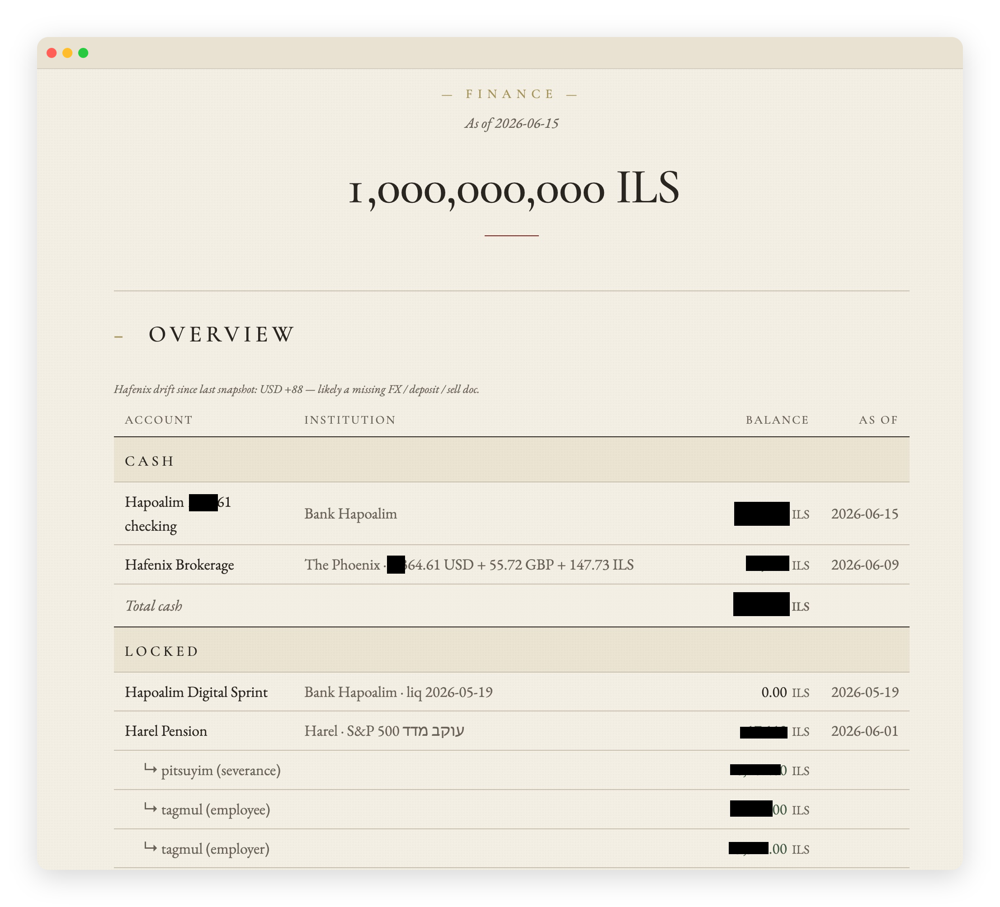
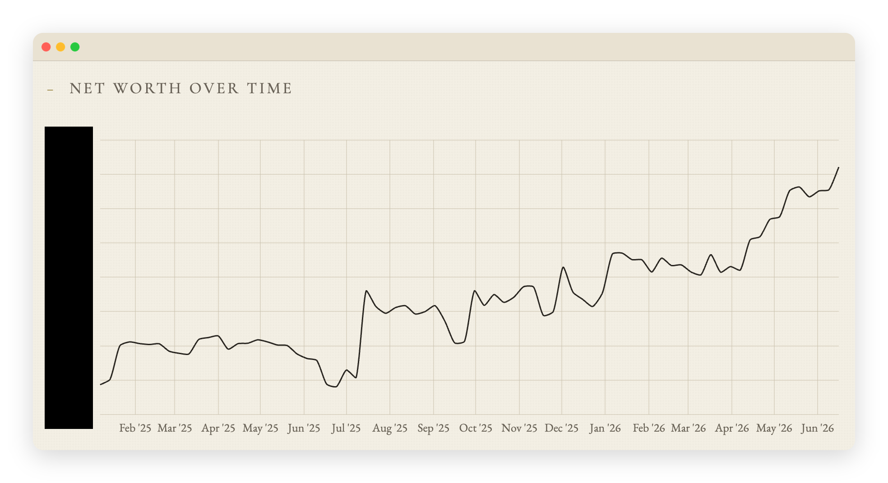
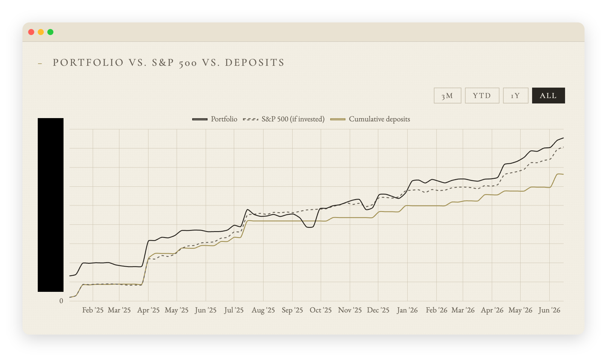
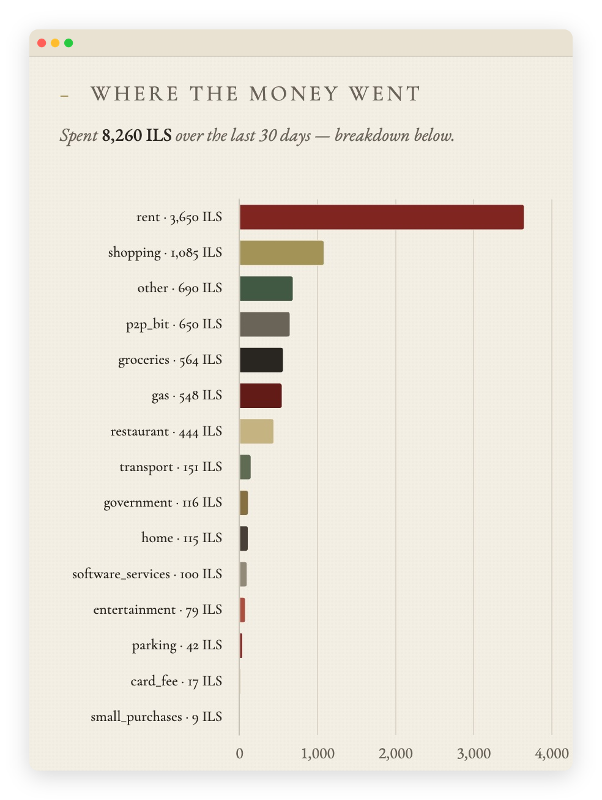
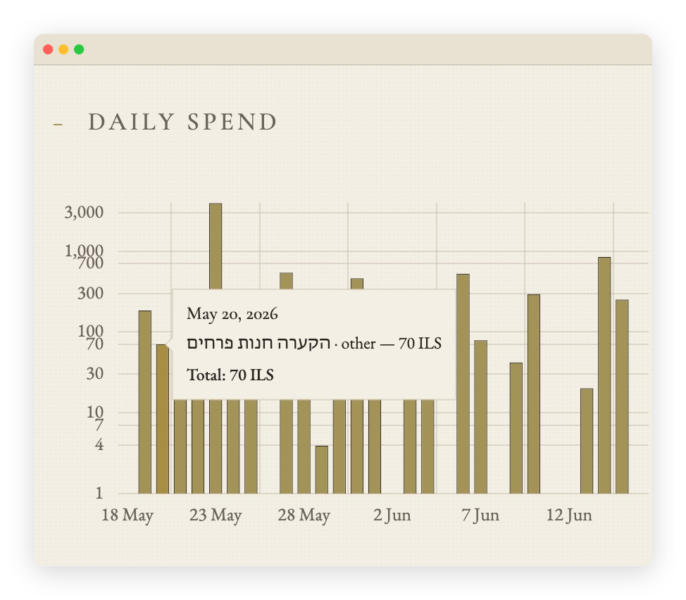
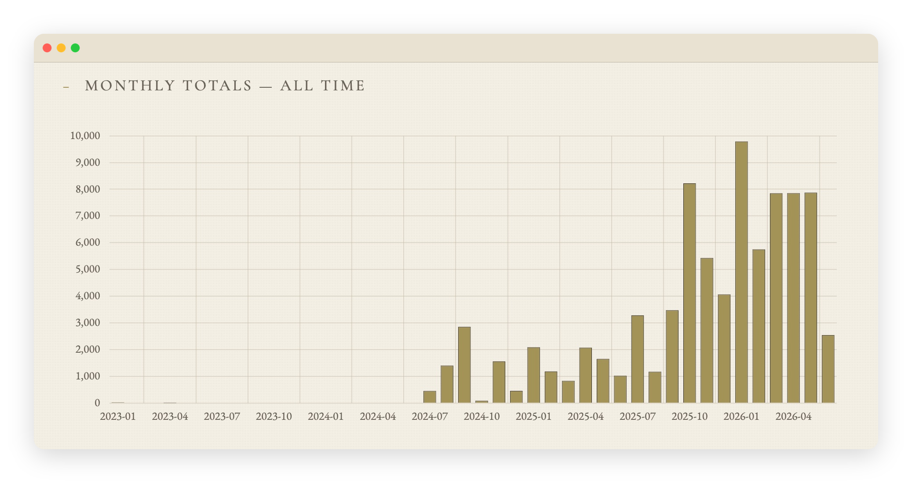
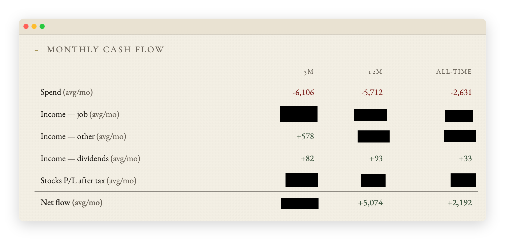
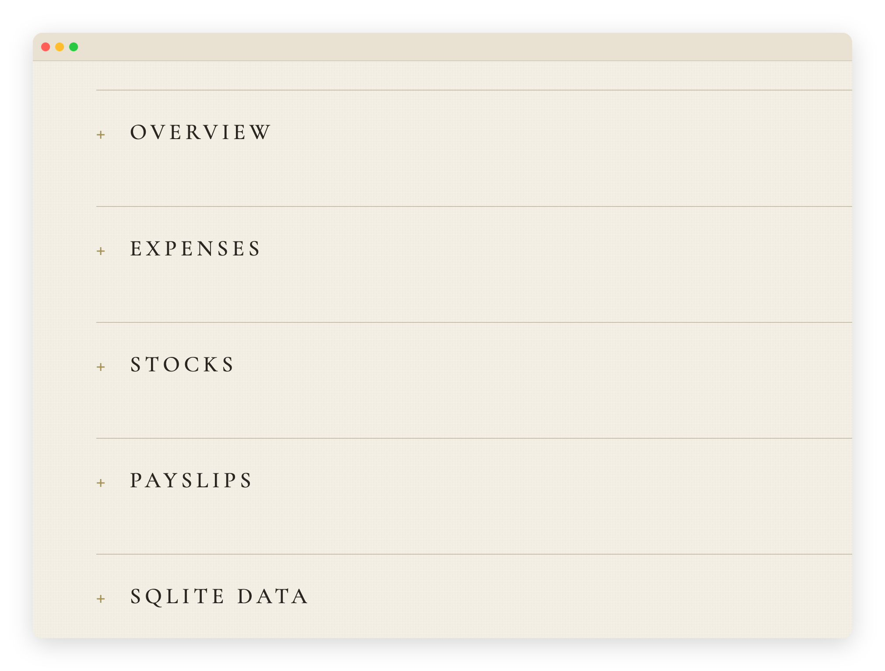
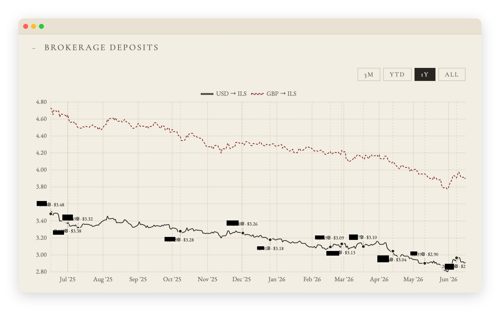

# FinDash

A Claude Code plugin for turning personal finance documents into an accurate SQLite-backed dashboard.

<p align="center">
  
</p>

<p align="center">
  
  
  
  
  
</p>

FinDash is a Claude Code plugin (`findash`) bundling a set of skills plus a small deterministic toolchain:

- **Skills reason** over messy real-world records — bank statements, payslips, brokerage screenshots, deposits, transfers, card charges.
- **Scripts do the mechanics** — parse files, update SQLite, cache market observations, serve React, and optionally send HTML to Telegram.

The core loop is deliberately split: collect and normalize every configured
source into SQLite, then choose an output. The local React app reads SQLite and
refreshes stock/FX observations every 30 minutes; Telegram delivery renders a
deterministic self-contained HTML snapshot only when requested.

> [!NOTE]
> **Built for Israel.** FinDash ships tuned for Israeli personal finance: automatic fetch covers **Bank Hapoalim** and **Cal** (via `israeli-bank-scrapers`), the default reporting currency is **₪ (ILS)**, and the schema models Israeli **payslips** (income tax, Bituach Leumi) and **retirement vehicles** (pension + training fund / קרן השתלמות). Dates parse as **DD/MM** and Hebrew/RTL text is handled throughout. The cash-flow dividend component uses gross modeled entitlement while cash confirmation is incomplete; modeled rows never enter the ledger, and recorded dividend cash and tax remain source-backed facts.
>
> **Living elsewhere?** Nothing is locked in — fork it and swap the locale-specific pieces. See [Adapting to another country](#adapting-to-another-country).

## What It Does

<table>
  <tr>
    <td width="50%">
      
    </td>
    <td width="50%">
      
    </td>
  </tr>
  <tr>
    <td><strong>Net worth over time</strong><br>Cash, locked savings, pension, training fund, and brokerage value roll into one view.</td>
    <td><strong>Investment benchmark</strong><br>Brokerage value is compared with recorded signed funding and a price-only S&amp;P 500 what-if seeded from the first valuatable portfolio state.</td>
  </tr>
</table>

<table>
  <tr>
    <td width="50%">
      
    </td>
    <td width="50%">
      
    </td>
  </tr>
  <tr>
    <td><strong>Expense breakdown</strong><br>Merchant-level credit-card rows and bank transactions are grouped into real spending categories.</td>
    <td><strong>Daily spend</strong><br>Recent spending is visible without opening a bank app or spreadsheet.</td>
  </tr>
</table>

<table>
  <tr>
    <td width="50%">
      
    </td>
    <td width="50%">
      
    </td>
  </tr>
  <tr>
    <td><strong>Monthly totals</strong><br>Long-running monthly expense history, including quiet months and spikes.</td>
    <td><strong>Monthly cash flow</strong><br>Average spend, income, and net flow are summarized across short, yearly, and all-time windows.</td>
  </tr>
</table>

<table>
  <tr>
    <td width="50%">
      
    </td>
    <td width="50%">
      
    </td>
  </tr>
  <tr>
    <td><strong>Sectioned dashboard</strong><br>Overview, expenses, stocks, payslips, and privacy-safe database diagnostics stay separated for quick scanning.</td>
    <td><strong>Brokerage deposits</strong><br>Deposit timing is shown against USD/ILS and GBP/ILS movement.</td>
  </tr>
</table>

## How It Works

```text
   +----------------------+          +----------------------+
   | Google Drive vault   |          | fetch-bank-data      |
   | dump/ (human drops:  |          | Hapoalim + Cal via   |
   | statements/PDF/XLSX) |          | israeli-bank-scrapers|
   +----------+-----------+          +----------+-----------+
              | best-effort pull                | local write
              v                                 v
   +---------------------------------------------------------+
   |            inbox/staging/  (local handoff)              |
   |      drive/<driveId>__file         fetched/pairs        |
   +----------------------------+----------------------------+
                                |                +-----------------+
                                v                | fetch-investments|
                     +----------------------+    | IBKR connector   |
                     | sync-finance-data    |    | (best-effort)    |
                     | AI interpretation    |    +--------+---------+
                     | audited inserts      |             |
                     +----------+-----------+             |
                                |     +-------------------+
                                v     v
                     +----------------------+
                     | SQLite (truth)       |----> weekly consistent snapshot
                     | deterministic math   |      to Drive (best-effort)
                     +----------+-----------+
                                |
                    +-----------+------------+
                    |                        |
                    v                        v
          +--------------------+   +----------------------+
          | React localhost app|   | send-finance-dashboard|
          | live quotes / 30m  |   | HTML → Telegram      |
          +--------------------+   +----------------------+
```

`sync-finance-data` owns the full update: bank/card fetch, best-effort IBKR, Drive gathering, staged ingestion, reconciliation, market-cache refresh, Drive filing, and the gated backup. It never renders or sends. `./run_dashboard.sh` runs the private localhost React view and appends current stock/FX observations to SQLite every 30 minutes. `send-finance-dashboard` reads the stored cache without refreshing it, writes one portable HTML file, and sends it plus the pending summary through Telegram.

The Telegram artifact remains self-contained: CSS, fonts, Chart.js, chart data, and markup are inlined into `output/dashboard.html`.

## The Skills

FinDash keeps data updates and output independent:

| Skill | Required? | What it does |
|---|---:|---|
| `/findash:setup` | Entry point | Guided first-time onboarding: auto-fixes the safe pieces and walks you through the rest. |
| `/findash:sync-finance-data` | Yes | Runs every configured source, ingests/reconciles SQLite, refreshes reference data, and attempts the weekly backup. No rendering or delivery. |
| `/findash:send-finance-dashboard` | Optional | Deterministically renders `output/dashboard.html` from cached SQLite state and sends it to Telegram. |
| `/findash:fetch-bank-data` | Optional | Uses `israeli-bank-scrapers` to pull fresh Hapoalim and Cal data into local staging for sync. |
| `/findash:fetch-investments` | Optional | Ingests IBKR trade history plus a reconciliation snapshot. The full sync attempts it best-effort; unattended syncs normally skip interactive auth. |
| `/findash:findash-doctor` | Recommended | Audits local setup and auto-fixes safe missing pieces. |

Skills live in [`skills/`](skills) and the plugin manifest in [`.claude-plugin/`](.claude-plugin). Claude Code loads them when you run `claude --plugin-dir .` from the repo root.

## Privacy Model

This repo is designed so the public code can be shared while private financial state stays local or in your Drive vault.

Secrets live in a single local INI file, `.secrets/findash` (chmod 600), with one section per integration. Omit any section you don't use:

```ini
# .secrets/findash — chmod 600. Omit any section you don't use.
[drive]
root_folder_id=<from your vault folder's Drive URL: drive.google.com/drive/folders/<ID>>

[hapoalim]
user_code=<your hapoalim user code>
password=<your hapoalim password>

[cal]
username=<your cal username>
password=<your cal password>

[telegram]
bot_token=<from @BotFather>
chat_id=<your numeric id, from @userinfobot>

[pdf-passwords]
<payslip-filename-pattern>=<password>
```

`rclone.conf` stays a separate file — it is rclone's own OAuth config, passed via `--config ./rclone.conf`.

The committed docs use placeholders for account suffixes, card suffixes, Drive IDs, balances, transaction IDs, and example amounts. Concrete mappings belong in the private SQLite DB or source documents, not in git.

When you run the Claude skills, Claude reads the documents needed for the task. That is the point of the system: Claude supplies the judgment layer, while SQLite and scripts provide the audit trail and repeatable math.

## Repo Map

```text
.claude-plugin/       plugin + marketplace manifests
skills/               plugin skills: setup, fetch, sync, Telegram send, doctor
dashboard/            React/Vite localhost dashboard
docs/                 project docs: schema, Drive layout, source document types
scripts/findash_core/ normalized accounting, cash-flow, migration, and HTML modules
scripts/              gateways, parsers, scrapers, API, renderer, sync runner
templates/            dashboard shell, CSS, and chart code
.secrets/findash      single local INI of credentials, gitignored
data/                 local SQLite database, gitignored
inbox/staging/        local fetch→sync handoff (deleted after ingest), gitignored
output/               rendered dashboard, gitignored
```

## Quickstart

For the full setup, read [docs/setup.md](docs/setup.md). The short version:

1. Install and authenticate [Claude Code](https://code.claude.com/docs/en/setup) and the local tools:

```bash
python3 --version       # required, >=3.10
rclone version          # Drive sync (optional when using bank-only/local input)
qpdf --version          # password-protected payslips only
node --version          # React dashboard and automatic bank fetch, >=22.13.0
```

Python 3.10 or newer is required.

2. Clone this repo and load the plugin from its root:

```bash
git clone https://github.com/ya5huk/findash.git
cd findash
claude --plugin-dir .
```

3. Run the guided onboarding — it auto-fixes the safe pieces and walks you through the rest:

```text
/findash:setup
```

4. Create `.secrets/findash` (chmod 600) from the single block in [Privacy Model](#privacy-model). Omit any section you don't use. `rclone.conf` stays separate; see [Drive + rclone setup](docs/setup.md#3-optional-connect-google-drive-with-rclone) and [Drive layout](docs/drive-layout.md).

5. Sync every configured source:

```text
/findash:sync-finance-data
```

Then choose an output independently:

```bash
./run_dashboard.sh
```

The app opens at `http://127.0.0.1:4173`. Invoke `/findash:send-finance-dashboard` only when you want a Telegram snapshot.

For unattended daily syncs, schedule the wrapper — it loads the plugin and runs `/findash:sync-finance-data`:

```bash
CLAUDE_BIN="$(command -v claude)" scripts/run_sync.sh
```

If you want unattended runs to fetch from Hapoalim or Cal, seed the browser profiles once before scheduling:

```bash
node scripts/fetch_bank.js --company=hapoalim --setup
node scripts/fetch_bank.js --company=visaCal --setup
```

In each browser window, log in, complete OTP/CAPTCHA, trust the device if
offered, wait for the account page, then press Enter in the terminal. If a bank
sends an OTP during a later unattended run, rerun the matching `--setup`
command; the run will continue with stale fetched data until the profile is
refreshed.

### Local checkout required

FinDash is packaged as a namespaced Claude Code plugin, but currently requires a
local checkout because scripts, templates, and private runtime state are rooted
beside the repository. Clone it and launch `claude --plugin-dir .`; standalone
marketplace installation is not supported yet.

## Optional Integrations

- Telegram: `/findash:send-finance-dashboard` renders and sends `output/dashboard.html` only when requested. See [Telegram setup](docs/setup.md#telegram-optional).
- Automatic bank/card fetch: pulls Hapoalim and Cal data through `israeli-bank-scrapers`. Unattended fetch requires a one-time interactive `--setup` per source to seed trusted-device cookies. Without it, manually upload statements or exports into Drive `dump/`. See [Bank fetch setup](docs/setup.md#automatic-bank-fetch-optional).
- Password-protected payslips: requires `qpdf` and a `[pdf-passwords]` section in `.secrets/findash`. Without it, skip payslip PDFs or add the passwords later.
- Interactive Brokers: ingests trade history plus a reconciliation snapshot through Anthropic's official connector. The full sync attempts it best-effort; unattended syncs skip interactive auth. See [IBKR setup](docs/setup.md#interactive-brokers-ibkr-portfolio-optional).

## Adapting to another country

FinDash is Israel-first, not Israel-only. The data model, scripts, and dashboard are generic; the locale-specific assumptions are concentrated in a handful of places, so a fork can re-point them without rewriting the core:

| Area | Where it's assumed | Swap it for |
|---|---|---|
| **Banks / card fetch** | `scripts/fetch_bank.js`, the `[hapoalim]`/`[cal]` secrets, and `fetch-bank-data` | Your country's banks — `israeli-bank-scrapers` covers many Israeli institutions, or wire in another scraper/aggregator. |
| **Tax treatment** | Source-recorded tax cash flows and payroll columns; no assumed capital-gains or dividend rate | Your jurisdiction's source documents and payroll fields. |
| **Base currency** | The accounting/model reporting-currency default, FX refresh target, and `en-IL` number formatting | Your reporting currency, FX pairs, and locale. |
| **Payslips & retirement** | `docs/doc-types/payslips.md`, `long-term-savings.md`, and the pension / training-fund columns in `scripts/init-db.sql` | Your payroll deductions and retirement products (401(k)/IRA, ISA, etc.). |
| **Dates & language** | DD/MM ambiguity handling in `scripts/xlsx_to_rows.py`; Hebrew/RTL handling in the templates and renderer | Your locale's date format and language. |

Most interpretation lives in the skills' prompts rather than hard-coded rules, so re-pointing those plus the constants above gets you most of the way. PRs that generalize these are welcome — see [Contributing](CONTRIBUTING.md).

## Docs

- [Setup](docs/setup.md) — Claude, React dashboard, Drive, Telegram, bank fetch, and daily syncs.
- [Drive layout](docs/drive-layout.md) — vault folders and filename conventions.
- [Document types](docs/doc-types/README.md) — what each source document contains and how Claude should interpret it.
- [SQLite schema](docs/sqlite-schema.md) — tables, money conventions, and audit rules.
- [Design system](docs/design-system.md) — dashboard visual rules.

## License

No open-source license is currently granted. All rights are reserved by the repository owner.
